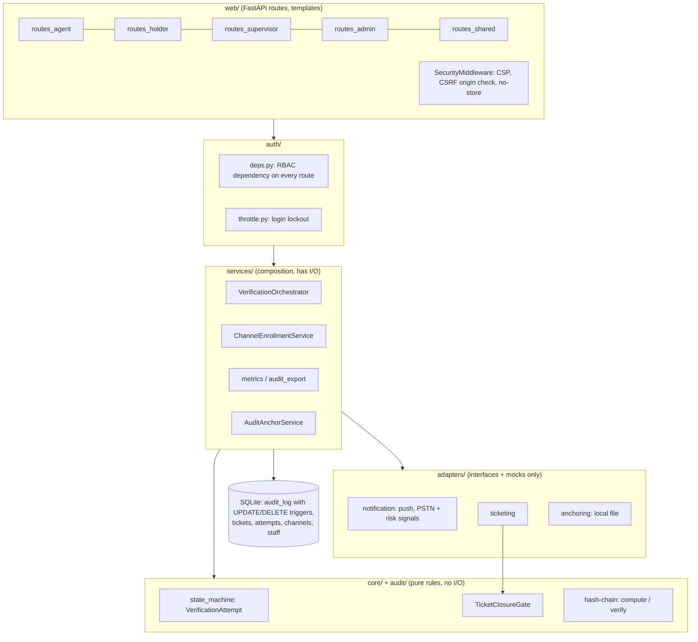
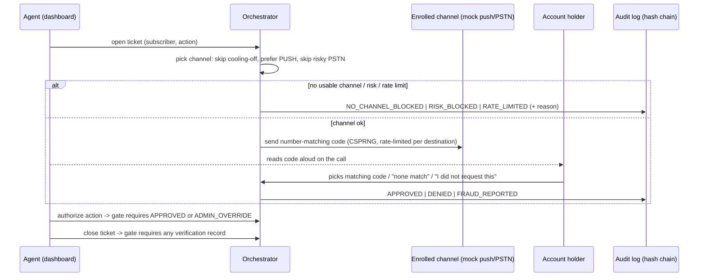

# Architecture

IVP is a single FastAPI process with server-rendered pages (Jinja2 + htmx)
and SQLite. It is organized as ports and adapters: the security rules live
in pure domain code with no I/O, and everything external (ticketing,
notifications, the anchor store) sits behind an interface with only mock
implementations.

## Layers



Rules of the road (from CLAUDE.md): `core/` never imports a framework or a
driver; only `db/` touches SQLite; routes never mutate a ticket's status
except through the ticketing adapter, which re-checks the closure gate
against the audit log every time.

## One verification, end to end



## Data model

| Table | Mutable? | Notes |
|---|---|---|
| `audit_log` | **No** | Append-only. SQLite triggers abort UPDATE/DELETE. Each row stores `prev_hash` and `record_hash` (SHA-256 of a canonical JSON payload). |
| `tickets` | status, action_performed, closed_at | Changed only via `TicketClosureGate`. |
| `verification_attempts` | state, code, attempt_number | Mirrors `core.state_machine.VerificationAttempt`. |
| `channel_enrollments` | No (insert only) | Stores a label and a SHA-256 fingerprint of the destination, never the raw number or token. `usable_from` implements cooling-off. |
| `staff_users` | Created by admins | Argon2 password hashes. |

Older databases are migrated additively on startup (`db/connection.py`,
`_migrate`). The audit table is never touched by a migration.

## Audit outcomes

| Outcome | Written by | Lets ticket close | Authorizes action |
|---|---|---|---|
| APPROVED | holder | yes | yes |
| DENIED | holder | yes | no |
| FRAUD_REPORTED | holder | yes | no |
| EXPIRED (final) | system | yes | no |
| ADMIN_OVERRIDE | admin, with reason | yes | yes |
| NO_CHANNEL_BLOCKED, RISK_BLOCKED, RATE_LIMITED | system, for the agent | no | no |
| REJECTED | holder (replayed link) | no | no |
| CHANNEL_ENROLLED | admin | n/a (not a ticket) | n/a |

## Verifying the evidence without the app

1. As admin, open **Full audit log** and click **Export CSV**.
2. Note the latest checkpoint's sequence and hash from the same page (or
   `demo_data/anchor_log.jsonl`).
3. Run the standalone verifier, which uses only the Python standard library
   and never imports this application:

```bash
python3 scripts/verify_audit_csv.py ivp-audit-<timestamp>.csv \
  --anchor-seq <sequence_up_to> --anchor-hash <chain_hash>
```

It recomputes every hash and link from genesis and checks the checkpoint.
A supervisor's team export is a subset, so only per-record hashes can be
checked there.

## Scaling and production notes

These are deliberate demo-scale choices, each with the production answer:

- **One SQLite connection shared across threads.** Fine for a demo; use a
  connection per request or Postgres for real concurrency. Two holders
  submitting the same attempt at the same instant could both read PENDING;
  a production store would make the state change a single conditional
  UPDATE.
- **In-memory login throttle and send rate limiter.** Reset on restart and
  per process. Move both to a shared store (Redis, or the database) before
  running more than one worker.
- **Stateless signed session cookie.** Logout deletes the cookie but can't
  revoke a copied one before it expires (1 h admin, 8 h others). A
  server-side session table would allow revocation.
- **CSRF by Origin check, not tokens.** See docs/decisions/web-hardening.md.
- **Local-file anchor store.** Demonstrates the pattern; a real deployment
  needs a store the database administrator doesn't control
  (docs/decisions/audit-anchoring.md).
- **Mock adapters only.** Real push, telephony, carrier risk feeds and
  ticketing systems plug in behind the existing interfaces without changing
  callers.
